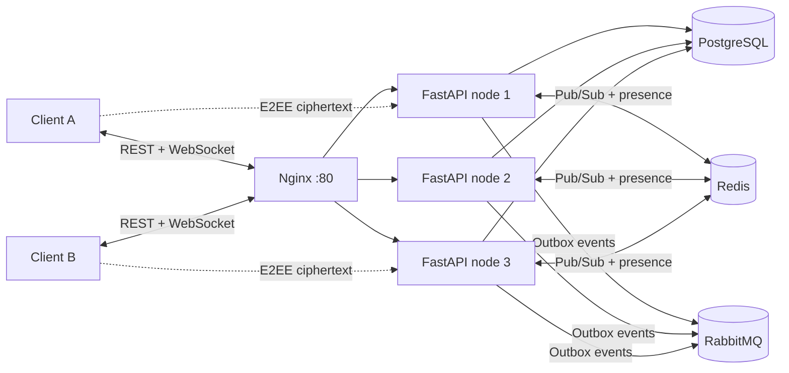

<div align="center">

# Distributed Chat

**A horizontally scalable, real-time chat backend with encrypted messages, presence, and multi-server WebSocket delivery.**

[](https://www.python.org/)
[](https://fastapi.tiangolo.com/)
[](https://www.postgresql.org/)
[](https://redis.io/)
[](#-why-this-project)

[Quick start](#-quick-start) · [Architecture](#-architecture) · [API](#-api-at-a-glance) · [Testing](#-testing) · [Contributing](#-contributing)

</div>

> **Project status:** This project is an active distributed-chat prototype. Review and replace the example credentials and secrets before using it outside a local development environment.

## ✨ Why this project?

Distributed Chat demonstrates how to keep real-time conversations available when users are connected to different application nodes:

- **Horizontal scaling** with three FastAPI server replicas behind Nginx.
- **Cross-node delivery** through Redis Pub/Sub.
- **Durable messaging** with PostgreSQL and a persist-before-publish flow.
- **Reliable asynchronous work** through RabbitMQ and an outbox event pipeline.
- **End-to-end message encryption** using client-side ECDH key agreement and AES-GCM.
- **Presence tracking** with Redis-backed online/offline state.
- **Operational visibility** with liveness and readiness endpoints.

## 🚀 Quick start

### Prerequisites

- [Docker Desktop](https://docs.docker.com/desktop/) with Docker Compose
- Git
- Python 3.11+ for the local client and test suite

### 1. Configure local secrets

```powershell
Copy-Item .env.example .env
```

Open `.env` and replace every placeholder secret. Never commit `.env`, private keys, or production credentials.

### 2. Start the distributed stack

```powershell
docker compose up -d
docker compose ps
```

The Compose stack starts:

| Service | Purpose | Port |
| --- | --- | ---: |
| `nginx` | Load balancer and WebSocket proxy | `80` |
| `postgres` | Durable application data | `5432` |
| `redis` | Pub/Sub and presence | `6379` |
| `rabbitmq` | Outbox/event messaging | `5672`, management UI `15672` |
| `chat_server_1..3` | FastAPI application replicas | internal `8000` |
| `watchtower` | Updates labeled chat images and removes old images | — |

### 3. Check that the cluster is ready

```powershell
curl.exe http://localhost/health/live
curl.exe http://localhost/health/ready
```

Open the interactive API documentation at [`http://localhost/docs`](http://localhost/docs).

<details>
<summary><strong>Stop, inspect, or reset the stack</strong></summary>

```powershell
# Stop containers without removing data
docker compose stop

# Follow application logs
docker compose logs -f chat_server_1

# Follow image update logs
docker compose logs -f watchtower

# Stop and remove containers and volumes
docker compose down -v
```

</details>

Watchtower polls Docker Hub every five minutes and updates only services labeled
`com.centurylinklabs.watchtower.enable=true`. In this stack, that means the three
chat server replicas; infrastructure services are not updated automatically.

## 🔐 Run the example clients

The repository includes two terminal clients representing User 1 and User 2. Each client:

1. Generates or loads a local key pair.
2. Registers its public key with the API.
3. Verifies peers using Trust On First Use (TOFU) fingerprints.
4. Derives a shared key with ECDH.
5. Encrypts messages locally before sending them over WebSocket.

Create a Python environment and install the client dependencies:

```powershell
conda env create -f environment.yml
conda activate chat-stage2
pip install -r client\requirements.txt
pip install -r client_bob\requirements.txt
```

Before starting the clients, update the token, user IDs, conversation ID, and API URL in:

- [`client/main.py`](client/main.py)
- [`client_bob/main.py`](client_bob/main.py)

Run them in separate terminals:

```powershell
python client\main.py
python client_bob\main.py
```

The checked-in client files contain placeholder tokens intentionally. Obtain real JWTs through `POST /auth/login`; do not commit real tokens.

## 🧭 Architecture



### Message delivery path

```text
Client encrypts
      ↓
WebSocket receives ciphertext
      ↓
PostgreSQL persists message + outbox event
      ↓
RabbitMQ processes the outbox
      ↓
Redis Pub/Sub fans out to the node holding the recipient connection
      ↓
Recipient receives ciphertext and decrypts locally
```

<details>
<summary><strong>Key design decisions</strong></summary>

- **Nginx** uses round-robin routing for REST traffic and preserves the WebSocket upgrade headers.
- **Redis Pub/Sub** bridges the gap between local WebSocket connection managers on different nodes.
- **PostgreSQL** is the source of truth; Redis is a transient real-time transport and presence store.
- **E2EE** keeps plaintext message content on the clients. The server persists and forwards the encrypted envelope.
- **Health probes** separate process liveness (`/health/live`) from dependency readiness (`/health/ready`).

</details>

## 📡 API at a glance

All protected endpoints use a JWT bearer token unless noted otherwise.

| Area | Method | Endpoint | Description |
| --- | :---: | --- | --- |
| Auth | `POST` | `/auth/register` | Create a user |
| Auth | `POST` | `/auth/login` | Issue an access token |
| Conversations | `POST` | `/conversations/` | Create or retrieve a conversation |
| Conversations | `GET` | `/conversations/` | List the current user's conversations |
| Messages | `GET` | `/conversations/{id}/messages` | Read paginated message envelopes |
| Keys | `POST` | `/keys/` | Register or rotate a public key |
| Keys | `GET` | `/keys/{user_id}` | Retrieve a peer public key |
| Presence | `GET` | `/users/{user_id}/presence` | Read a user's presence |
| Health | `GET` | `/health/live` | Fast liveness probe |
| Health | `GET` | `/health/ready` | PostgreSQL and Redis readiness |
| Realtime | `WS` | `/ws/chat?token={jwt}` | Send and receive chat events |

Interactive OpenAPI documentation is available at `/docs`; the raw schema is available at `/openapi.json`.

## 🛠️ Local development

The backend reads configuration from `.env` using Pydantic Settings. For local, non-Docker execution, point `DATABASE_URL`, `SYNC_DATABASE_URL`, `REDIS_URL`, and `RABBITMQ_URL` at services running on `localhost`.

```powershell
conda activate chat-stage2
pip install -r requirements.txt
alembic upgrade head
uvicorn app.main:app --reload --host 0.0.0.0 --port 8000
```

The current Compose file uses the published `pinsara23/distributed-chat:latest` image for the application nodes. If you want to build a new image locally, ensure the image build context includes the dependency file referenced by [`Dockerfile`](Dockerfile) before using a custom build workflow.

## ✅ Testing

The test suite uses `pytest-asyncio` and expects a PostgreSQL test database named `chat_test_db` on the configured local PostgreSQL instance.

```powershell
conda activate chat-stage2
pytest
```

Run a focused test file when iterating:

```powershell
pytest tests\test_e2ee.py -q
pytest tests\test_redis_messaging.py -q
```

## 📁 Repository map

```text
app/
├── api/             REST endpoints and dependencies
├── core/            settings, database, encryption, security
├── messaging/       Redis and RabbitMQ integrations
├── models/          SQLAlchemy persistence models
├── presence/        Redis-backed presence service
├── schemas/         Pydantic request/response models
├── services/        authentication, chat, key, and health services
└── websocket/       authenticated real-time chat endpoint
client/              User 1 encrypted terminal client
client_bob/          User 2 encrypted terminal client
alembic/              Database migrations
nginx/                Reverse proxy and WebSocket configuration
tests/                Async API, encryption, and messaging tests
```

## 🤝 Contributing

1. Create a focused branch.
2. Make the smallest complete change.
3. Add or update tests for behavior changes.
4. Run `pytest` before opening a pull request.
5. Document configuration or API changes in this README and the OpenAPI surface.

## 📄 License

No license file is currently included. Add a `LICENSE` file before distributing this project publicly.
