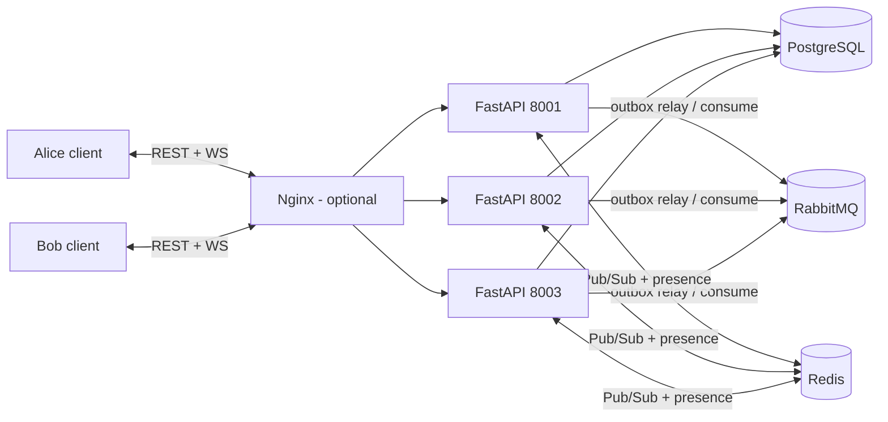

# Distributed Chat

A distributed, end-to-end encrypted chat backend. Several FastAPI servers share
PostgreSQL, relay events through RabbitMQ (transactional outbox) and fan messages
out to the right WebSocket through Redis Pub/Sub. The server only ever stores and
forwards **ciphertext**.

> **Status:** educational prototype. See [Security limitations](#security-limitations)
> before using it for anything real.

## Architecture



| Component | Role | Failure behaviour |
| --- | --- | --- |
| **PostgreSQL** | Source of truth: users, conversations, ciphertext messages, outbox, processed events | Writes fail loudly; the sender gets an error, never a false "sent". |
| **Redis** | Cross-server real-time delivery (Pub/Sub), presence with TTL, in-flight claims | Chat keeps working; the listener resubscribes with backoff; missed live messages are recovered by client sync. |
| **RabbitMQ** | Reliable hand-off of `message.created` events (retries, dead-letter queue) | The API still starts and accepts messages; events wait in the outbox and are relayed when the broker returns. |
| **Nginx** | Optional round-robin + WebSocket proxy | A dead server is skipped by Nginx; clients reconnect with backoff. |

### Life of one message (Alice → Bob)

1. Alice's client derives a shared key (X25519 ECDH + HKDF), generates a `message_id` (UUID), builds the
   AAD and encrypts with AES-GCM. **Plaintext never leaves the client.**
2. Alice sends `{message_id, conversation_id, target_user_id, ciphertext, nonce, key_version}` over her WebSocket
   (server A). Unknown fields such as `content` are rejected.
3. Server A checks both users belong to the conversation, then in **one PostgreSQL transaction** stores the message
   and a `message.created` outbox event. Only after the commit does anything get published.
4. Server A echoes the stored message to Alice (her client then stops re-sending it).
5. The outbox publisher (any server) leases the event, publishes it to RabbitMQ with publisher confirms, then marks it
   published. No database lock is held while talking to RabbitMQ.
6. A consumer (any server) takes the event, checks `processed_events` (idempotency), loads the message from PostgreSQL
   (claim-check: the event carries IDs, not content) and publishes it to Redis channel `chat:user:<bob>`.
7. Every server hears that channel; the one holding Bob's socket pushes the ciphertext to him. The event is recorded in
   `processed_events` and the RabbitMQ message is acked.
8. Bob's client rebuilds the AAD from the envelope, decrypts, and remembers the message id.
9. If Bob was offline, he calls `GET /conversations/{id}/messages?after_id=…` on reconnect and decrypts what he missed.

### Reliability mechanisms

- **Persist before publish**: the message and its outbox row commit together.
- **Outbox with leases**: crash-safe, at-least-once relay; multiple publishers never claim the same row (`SKIP LOCKED`).
- **Idempotent consumer**: durable `processed_events` table + a short Redis claim for in-flight work.
- **Bounded retries**: 3 attempts, then the event is dead-lettered to `chat.msg.dlq` (also when Redis is down).
- **Presence**: `presence:user:<id>` with a 30 s TTL refreshed by the client heartbeat (10 s). A crashed server cannot leave
  anyone online forever; a server only deletes presence it still owns.
- **Dead connections**: the server drops sockets silent for 45 s.
- **Client**: re-authenticates on every reconnect, exponential backoff, resends unacknowledged messages
  (idempotent by `message_id`), syncs missed messages and de-duplicates by message id.
- **Graceful shutdown**: closes sockets, cancels and *awaits* background tasks, closes RabbitMQ/Redis/DB.
- **Health**: `/health/live` (process) and `/health/ready` (PostgreSQL + Redis + RabbitMQ).

## End-to-end encryption

| Item | Choice |
| --- | --- |
| Identity key | X25519 key pair generated and kept on the client (`<user>_identity.key`, PEM, **not** passphrase-protected) |
| Key agreement | Static-static ECDH, then HKDF-SHA256 (`info = distributed-chat-e2ee-v1`) |
| Cipher | AES-256-GCM, random 96-bit nonce per message |
| Trust | TOFU: the first fingerprint (SHA-256 of the PEM) is stored in `<user>_known_hosts.json`; a changed key triggers a warning and an explicit prompt |
| Server | Stores public keys only. It validates they are X25519 and bumps `key_version` only when the key really changes |

### Associated data (AAD)

Every message's AES-GCM tag also authenticates a header, so the server (or anyone) cannot move a ciphertext to another
conversation, claim another sender, replay it under another id, or change the protocol version. It is built by exactly
one function, `build_aad` in [`client/crypto.py`](client/crypto.py), used by the sender, the receiver and the tests:

```text
dchat-e2ee|v<protocol_version>|<message_id>|<conversation_id>|<sender_id>
e.g.  dchat-e2ee|v1|3f2b8c1e-5a47-4d0a-9b6e-1c2d3e4f5a6b|7|1
```

`message_id` is the lowercase hyphenated UUID; the other fields are base-10 positive integers. No field can contain `|`,
so the encoding is unambiguous. Changing the layout requires bumping `PROTOCOL_VERSION`. The receiver builds the AAD from
the envelope fields the server supplies (`message_uuid`, `conversation_id`, `sender_id`), so a lying server causes
authentication to fail rather than a forged message being accepted.

### Security limitations

- **No forward secrecy / no key ratchet**: the long-term shared key protects every message; compromise of a private key
  exposes all past and future messages between that pair.
- **TOFU only**: the first key a client sees is trusted. Compare fingerprints out of band to defeat a malicious server on
  first contact.
- **Identity keys are stored unencrypted** on disk.
- **Metadata is visible to the server**: who talks to whom, when, sizes, presence.
- **Rotating a key** (`key_version`) is detected by peers (TOFU prompt) but there is no multi-device or key-history support.
- JWTs travel in the WebSocket query string (access logs may record them). Access tokens are not revocable.
- Development defaults (JWT secret, passwords) must be replaced before any real deployment.

## Local setup (Windows, no Docker)

PostgreSQL and pgAdmin run on Windows; Redis and RabbitMQ run inside WSL; Python dependencies live in the
`chat-stage2` conda environment. (The Docker files below are for the server deployment and are not used on this machine.)

```powershell
conda env create -f environment.yml      # first time only
conda activate chat-stage2
Copy-Item .env.example .env              # then edit: passwords, JWT_SECRET_KEY, localhost URLs
```

`.env` must point `DATABASE_URL` (`postgresql+asyncpg://…@localhost:5432/chat_db`), `REDIS_URL` and `RABBITMQ_URL`
at your local services. Create the databases, then run the migration:

```powershell
alembic upgrade head
```

Start three servers (one terminal each) with distinct ids:

```powershell
$env:SERVER_ID="chat-server-1"; uvicorn app.main:app --port 8001
$env:SERVER_ID="chat-server-2"; uvicorn app.main:app --port 8002
$env:SERVER_ID="chat-server-3"; uvicorn app.main:app --port 8003
```

Nginx is optional: [`nginx.txt`](nginx.txt) is a local config that balances ports 8001–8003 on `:8000`. Without it,
connect each client straight to a port.

```powershell
curl.exe http://localhost:8001/health/ready
```

### Resetting the development environment

Because the schema is a single initial migration, a reset means dropping and recreating the databases (stop all servers
first). In `psql` (or pgAdmin's query tool, connected to the `postgres` database):

```sql
SELECT pg_terminate_backend(pid) FROM pg_stat_activity
 WHERE datname IN ('chat_db', 'chat_test_db') AND pid <> pg_backend_pid();
DROP DATABASE IF EXISTS chat_db;
DROP DATABASE IF EXISTS chat_test_db;
CREATE DATABASE chat_db;
CREATE DATABASE chat_test_db;
```

Then `alembic upgrade head` (the test database is built by the test suite itself). Also clear transient state that refers
to the old rows: `redis-cli FLUSHDB`, purge the RabbitMQ queues `chat.message.queue` and `chat.msg.dlq`, and delete the
clients' `*_message_cursor.json` files.

## Deployment (Docker, server machine)

Pushing to `new-version` runs GitHub Actions: **tests → image build → push** to Docker Hub as
`<user>/distributed-chat:latest` and `:<commit-sha>`. Nothing is pushed unless the tests (and an
`alembic check` that the migration matches the models) pass. Repository secrets required:
`DOCKERHUB_USERNAME`, `DOCKERHUB_TOKEN`.

On the server, keep `docker-compose.yml`, `nginx/nginx.conf` and a filled-in `.env` (from `.env.example`) in one folder:

```bash
docker compose pull
docker compose up -d
```

Compose starts everything in order: PostgreSQL / Redis / RabbitMQ (healthy) → **`migrate`** (one-shot
`alembic upgrade head`) → the three chat servers → Nginx. If the migration fails the chat servers are not
replaced; read why with `docker compose logs migrate`. Only Nginx (port 80) and the RabbitMQ management UI
(15672) are published; PostgreSQL, Redis and AMQP are internal.

```bash
docker compose ps                      # everything healthy, migrate "Exited (0)"
curl http://localhost/health/ready     # PostgreSQL, Redis and RabbitMQ all "ok"
IMAGE_TAG=<commit-sha> docker compose up -d   # pin or roll back to a specific build
```

## Web UI (WhatsApp-style)

A browser frontend lives in [`frontend-ts/`](frontend-ts/) (TypeScript, Vite + React 18). It speaks the same E2EE protocol as
`client/main.py` using the Web Crypto API (X25519 + HKDF + AES-GCM with the same AAD), so browser and terminal clients can
chat with each other. The backend is unchanged.

The backend has no CORS middleware, so the browser talks to a same-origin proxy that forwards `/backend/<port>/...` (REST and
WebSocket) to `127.0.0.1:<port>` (8000-8003 only): the Vite dev server in development, `frontend-ts/serve.py` for the build.
Start the three servers as above, then:

```powershell
cd frontend-ts
npm install
npm run dev                 # http://localhost:3000 (dev server with the proxy)
```

or build once and serve without Node:

```powershell
npm run build               # type-checks, then writes dist/
conda activate chat-stage2
python serve.py             # http://localhost:3000 (FRONTEND_PORT to change)
```

Open `http://localhost:3000`, create an account, and start a chat with another user's **user ID** (shown under your name).
Use two browser tabs (or two browsers) with different accounts to try the multi-server demo; "Auto" server mode fails over
between 8001-8003. Needs Chrome/Edge 133+, Firefox 130+ or Safari 17+ (X25519 in Web Crypto) on `localhost` or HTTPS.

Features: unread badges, online status, security-code (TOFU) warnings, emoji picker, in-chat search (Enter / Shift+Enter to
step through matches), per-chat drafts, "scroll to latest" button, copy message, desktop notifications, `Ctrl/Cmd+K` to focus
chat search and `Esc` to close a chat.

Notes / limits (because the backend API is unchanged):
- No user search or profile names: contacts are user IDs; the display name you give a contact is stored only in your browser.
- The server does not say who a conversation is with; the UI infers it from messages or asks you to confirm the ID.
- Identity keys live in this browser's IndexedDB (non-extractable). Clearing site data, or signing in from another browser or
  the Python client, creates a new key: old messages from before the change can no longer be decrypted and peers see a
  "security code changed" prompt (TOFU).
- Only a single tick is shown (stored on server); there are no delivery/read receipts, typing indicators or media.
- Message history is re-downloaded and decrypted on each load; no plaintext is saved in the browser.

## Running the clients

The same client serves every user; configure it with environment variables (a `CHAT_USER_ID`-based prefix keeps each
user's key, fingerprints and sync cursor separate). Register users and create a conversation through `/docs`, then:

```powershell
# Alice (user 1)
$env:CHAT_USERNAME="alice"; $env:CHAT_PASSWORD="…"; $env:CHAT_USER_ID="1"; $env:CHAT_TARGET_USER_ID="2"
$env:CHAT_CONVERSATION_ID="1"; $env:CHAT_SERVER_HOST="localhost:8001"; python client\main.py

# Bob (user 2), another terminal
$env:CHAT_USERNAME="bob"; $env:CHAT_PASSWORD="…"; $env:CHAT_USER_ID="2"; $env:CHAT_TARGET_USER_ID="1"
$env:CHAT_CONVERSATION_ID="1"; $env:CHAT_SERVER_HOST="localhost:8002"; python client\main.py
```

Passwords can be omitted to be prompted instead. Never commit `*.key` or `*known_hosts.json` (they are git-ignored).

## API

| Area | Method | Endpoint | Description |
| --- | :---: | --- | --- |
| Auth | `POST` | `/auth/register` | Create a user |
| Auth | `POST` | `/auth/login` | Issue an access token (form fields `username`, `password`) |
| Conversations | `POST` / `GET` | `/conversations/` | Create-or-get a 1:1 conversation / list mine |
| Messages | `GET` | `/conversations/{id}/messages` | History: `page`+`limit`, or `after_id` for sync (ciphertext envelopes) |
| Keys | `POST` | `/keys/` | Register or rotate your X25519 public key |
| Keys | `GET` | `/keys/{user_id}` | Fetch a peer's public key |
| Presence | `GET` | `/users/{user_id}/presence` | `online` / `offline` / `unknown` |
| Health | `GET` | `/health/live`, `/health/ready` | Liveness / dependency readiness |
| Realtime | `WS` | `/ws/chat?token={jwt}` | Chat frames (below) |

WebSocket frames: client → server `{"type":"ping"}` or a message
`{message_id, conversation_id, target_user_id, ciphertext, nonce, key_version}`; server → client `{"type":"pong"}`, a message
envelope `{id, message_uuid, conversation_id, sender_id, ciphertext, nonce, key_version, created_at}`, or
`{"error", "message_id"?, "retryable"?}`.

## Testing

Tests need only the local PostgreSQL (an empty `chat_test_db`); they do not need Redis, RabbitMQ or Docker.

```powershell
conda activate chat-stage2
pytest
```

They cover the E2EE primitives and AAD binding, the WebSocket handler, the outbox lease SQL and processed-events table
against real PostgreSQL, the consumer's ack/nack/retry/dead-letter logic, the Redis listener's resubscription, the
client's sync/dedup/outbound queue, and startup/shutdown behaviour.

## Layout

```text
app/
├── api/          REST endpoints and dependencies
├── core/         settings, database, JWT/password security
├── messaging/    Redis Pub/Sub, RabbitMQ topology/consumer/outbox publisher/workers
├── models/       SQLAlchemy models (messages store ciphertext only)
├── presence/     Redis presence with TTL
├── schemas/      Pydantic models, incl. the WebSocket message schema
├── services/     auth, chat, key and health services
└── websocket/    authenticated chat endpoint + local connection manager
client/           reference terminal client (E2EE, reconnect, sync, outbound queue)
alembic/          single initial migration
tests/            pytest suite
```
